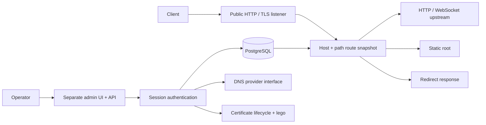
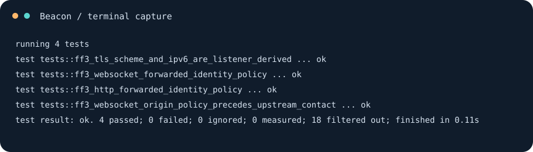
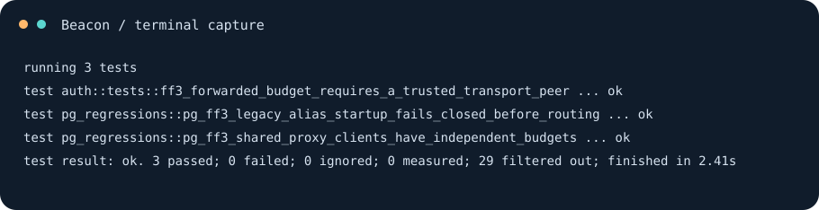

<p align="center"></p>

# Beacon

### Your sites. One front door.


**A Rust edge server where sites are database rows.** Route hosts and paths to reverse proxies, static files, redirects or WebSockets. Manage them through an administrative API backed by PostgreSQL, with DNS and TLS integrations when configured.

[Explore the landing page](https://gavinbombay.github.io/beacon/) · [Architecture](#architecture) · [Quickstart](#quickstart) · [Deploying behind a proxy](#deploying-behind-a-proxy) · [Security notes](docs/SECURITY.md)

Beacon grew out of the difficulty of letting automated tools edit one shared server configuration. Give each site a row and a handler instead: change the site you mean, then publish a route snapshot. The lighthouse artwork and the line "Build your own, so you can break your own" come from the original Beacon story. Deployment totals are intentionally not product guarantees.

Status: early open-source release (v0.2). APIs and configuration may change. This prepared landing page will become available when the repository is published and Pages is enabled separately.

## Features

- Host and path routing, including composite handlers and prefix rewriting.
- Reverse proxying and WebSocket bridging, static files with a local 404 page, and redirects.
- Administrative UI and API, PostgreSQL persistence, and route snapshot publication.
- Local-only management by default, bounded login verification, explicit proxy trust and optional WebSocket Origin checks.
- TLS through rustls, hot certificate selection and ACME DNS challenges through a separately installed lego client.
- A provider interface with Porkbun implemented; Cloudflare is a non-production skeleton.
- Optional TCP/UDP game forwarding behind the `game_forward` build feature.

## Architecture



Public TLS and administrative HTTP are separate listeners. The admin API coordinates site writes and routing. DNS automation and certificate issuance depend on operator configuration and available provider tooling.

## Screenshots

These are **terminal captures**, generated from actual sandbox regression output, not mock dashboards. The lighthouse images are illustrations.





Captured text is committed beside each image. Regenerate with `python3 -B docs/tools/render-captures.py`; see [capture provenance](docs/CAPTURES.md).

## Quickstart

Use Rust and Cargo 1.98.1, provision a PostgreSQL database, and populate the dependency cache before an offline build:

```sh
git clone https://github.com/Gavinbombay/beacon
cd beacon
sh ./check-toolchain.sh
cargo build --locked --offline --release
# Supply BEACON_CONFIG_JSON using the configuration shape below.
./target/release/beacon
```

Startup validates configuration and runs migrations before opening listeners. See Configuration for required runtime values and Build for repeatable tests.

## How the DNS adapter works

- `beacon-dns` defines the `DnsProvider` trait: `ensure_record_with_change` (idempotent create or update, returning what changed), `rollback_change` (undo that exact change) and `wait_for_propagation`.
- `beacon-core/src/provider.rs` holds the provider registry (`ProviderSpec`). Each entry names the provider, says whether it is implemented, picks its record adapter, and maps configured values (`dns.api_key`, `dns.secret_key`) to the environment variables the ACME client (lego) expects for DNS-01 challenges.
- `beacon_dns::provider()` turns `dns.provider` from the config into a concrete adapter. The certificate lifecycle reads the same registry entry, so there is no provider-specific branch anywhere else. Unknown names fail loudly, and skeleton providers return a typed error instead of silently falling back.

Today: `porkbun` is implemented; `cloudflare` is a registered skeleton you can use as the starting point for a contribution.

## Build

Use Rust and Cargo 1.98.1 with rustfmt. The lockfile pins the dependency graph. With those exact tools on PATH and the dependency cache already populated, run:

```sh
sh ./check-toolchain.sh
cargo fmt --all -- --check
cargo test --locked --offline --workspace --all-targets
cargo build --locked --offline --release
cargo test --locked --offline --workspace --all-targets --features game_forward
cargo build --locked --offline --release --features game_forward
```

Offline builds require an independently provisioned Cargo cache; dependencies are not included in this repository. The optional game forwarding feature is off by default.

Run the two test commands above from a disposable copy with the PostgreSQL fixture described below and `BEACON_TEST_DATABASE_URL` set. The transport tests use isolated loopback listeners; the database fixture uses a private Unix socket. Run `node --test tests/ui.test.cjs` for the DOM helpers. Node is needed only for the DOM helper check. Forwarding's internal tests can also be run from that copy with `cargo test --offline --manifest-path crates/beacon-forward/Cargo.toml`; this excluded optional crate creates its own local lockfile. Default workspace tests exclude it. Enabling the feature builds its runtime and enables different UI, persistence and binary tests.

On Windows with Git Bash, invoke the toolchain check using the Git installation's `sh.exe`. When the pinned toolchain is unavailable offline, explicitly select an installed toolchain through `RUSTUP_TOOLCHAIN`, record its exact version, and expect the check script to fail until the pin is installed. Do not change the pin to hide that mismatch.

## Configuration

Set `BEACON_CONFIG_JSON` to a JSON object containing `server`, `brain`, `dns`, and `store`. `server` can be an empty object to use the port defaults. `brain` requires `api_key`, `api_base`, and `model`; `dns` requires `default_ip`, and optionally `provider`, `api_key`, and `secret_key`; `store` requires `database_url`. Values must be supplied by the operator. The process fails with a configuration error if the database URL, API key, API base, model, or DNS IP is missing or invalid. Optional `auth`, `tls`, `proxy`, `sites`, and `domains` are defined in `crates/beacon-core/src/config.rs`. A minimal configuration shape follows (replace each placeholder with an operator-supplied value):

```json
{"server": {}, "brain": {"api_key": "<TOKEN>", "api_base": "<LLM_URL>", "model": "<MODEL>"}, "dns": {"provider": "porkbun", "default_ip": "<PUBLIC_IP>"}, "store": {"database_url": "<DATABASE_URL>"}}
```

Run `target/release/beacon` after configuring a reachable database. Startup runs database migrations.

The administrative UI is served on the configured admin port. Set `BEACON_TOKEN_KEY` and `BEACON_TOKEN_HEADER` to override its browser storage key and request header. Set `BEACON_METRICS` to `true` to expose `/metrics` on the public router. DNS provider `porkbun` is supported for record management; `cloudflare` is a non-production skeleton that returns a typed error. DNS and the lego adapter share the capability registry in `beacon-core/src/provider.rs`; unsupported selectors fail explicitly. Lego must be installed separately. The Cloudflare skeleton does not issue certificates.

Management uses HTTP independently of public TLS. Place the management listener behind a trusted encrypted tunnel or HTTPS ingress, protecting every backend hop from untrusted peers. Public TLS does not encrypt management traffic. The admin listener defaults to IPv4 loopback through `server.admin_host`, independently of the public `server.host`. Existing configurations that set only `server.host` now retain local-only administration. To opt into a remote or wildcard admin bind, explicitly set `server.admin_host` to an IP address and enable `auth`; startup rejects non-loopback administration with auth disabled. IPv6 addresses are supported. Omitting `auth` allows anonymous administration only on loopback. Enable `auth` with a nonempty username and operator-supplied password for authenticated administration. Do not expose anonymous management to untrusted networks. The management page denies framing; API text is rendered as text, including model responses and provider diagnostics.

Administrative site writes and authoritative route reads share a Store mutex through snapshot publication. Writes clear routes before their first database await, including writes later cancelled during a post-commit reread. Reloads clear the cached snapshot before awaiting the database, so query errors and cancelled reloads withdraw cached routes until the next successful refresh. Partial updates preserve omitted fields using the current PostgreSQL row, including concurrent changes from another Store connection. This deliberately favors withdrawal over availability. Forward deletion or replacement stops and joins admitted workers before reconciliation returns. UDP sessions have a fixed admission cap; reaching it rejects new sessions while preserving existing owners. Reply pumps accept only the selected responder. Desired-state reads and applies share a reconciliation lock; new callers must use `reconcile_from` rather than loading a snapshot before `apply`.

Static roots must be trusted and protected from concurrent modification by untrusted users. Missing files use a root-local `404.html` when present. Review `NOTICE` and dependency licenses before distribution.

## Architecture and capabilities

The public HTTP router serves static files, proxies requests and redirects; the admin API coordinates PostgreSQL persistence, DNS and TLS. The brain adapter connects to an operator-selected model endpoint. Game forwarding is an optional feature.

| Capability | Status |
| --- | --- |
| Static `404.html` | implemented per spec; live parity unverified |
| Configurable UI storage key and header | implemented per spec; live parity unverified |
| Opt-in `/metrics` | implemented per spec; live parity unverified |
| Porkbun DNS | implemented |
| Cloudflare DNS | non-production skeleton |
| Game forwarding | opt-in build feature |

## Configuration reference

| Setting | Purpose |
| --- | --- |
| `BEACON_CONFIG_JSON` | Required JSON configuration described above |
| `BEACON_TOKEN_KEY` | Browser storage key override |
| `BEACON_TOKEN_HEADER` | Administrative request header override |
| `BEACON_METRICS` | Enable metrics when true |

| JSON field | Validation |
| --- | --- |
| `server` | Required object; ports default when omitted within it |
| `server.admin_host` | IP address; defaults to loopback; non-loopback requires enabled auth |
| `brain.api_key` | Required nonempty string, supplied at runtime |
| `brain.api_base` | Required absolute HTTP or HTTPS URL with a host |
| `brain.model` | Required nonempty operator-supplied identifier; no default |
| `dns.default_ip` | Required IPv4 or IPv6 address |
| `dns.provider` | Optional; empty selects Porkbun; unknown names fail provider construction |
| `dns.api_key`, `dns.secret_key` | Optional for config parsing; required by the supported lego adapter |
| `store.database_url` | Required absolute postgres or postgresql URL with a host |
| `auth` | Optional; enabled mode requires nonempty username/password and positive session TTL |

Malformed JSON, wrong field types, missing required sections or fields, empty required strings, invalid URL schemes/hosts and malformed addresses fail startup validation. Errors identify fields without echoing configured values. Debug formatting redacts sensitive configuration structs. API values and model identifiers belong in runtime configuration, never in source fixtures.

## Adding a DNS provider

1. In `crates/beacon-core/src/provider.rs`, add a `RecordAdapter` variant and a `ProviderSpec` entry: `name` (the `dns.provider` value), `implemented`, `adapter`, `lego_name` (lego's provider selector) and `lego_env` (lego environment variable names mapped to `DnsValue::ApiKey` / `DnsValue::SecretKey`).
2. In `crates/beacon-dns/src/lib.rs`, implement `DnsProvider` for your adapter (create/update must be idempotent and return a `DnsChange` that `rollback_change` can undo), then add its arm to `provider()`.
3. Add fixture tests as described below. Never call a real provider API from tests.
4. Document the provider in the capability table.

Implement `DnsProvider` in `beacon-dns`, including idempotent record creation and rollback. Add a record adapter kind and registry entry in `beacon-core/src/provider.rs`, then wire that adapter in the DNS factory. The entry declares lego's provider selector and mappings from configured values to environment key names. Lego's command builder consumes that data without a provider-specific branch in the certificate lifecycle. Mark incomplete adapters as skeletons. Cover create, update, no-op, update failure restoration, cleanup, propagation timeout, API errors, ACME failure/fallback, required email/domains and renewal with injected in-process transport, resolver and clock fixtures. Production endpoints remain in transport construction; fixtures inject their own endpoint. Do not call a real provider from tests.

## Troubleshooting

Check required configuration fields and JSON syntax on startup errors. Offline builds require the pinned toolchain and an already populated Cargo cache. For certificate issues, check the configured domains and email and the separately installed ACME client; self-signed fallback depends on configuration.

## Security reporting

Please report vulnerabilities privately through GitHub's private vulnerability reporting (the repository's **Security** tab, then **Report a vulnerability**), not through public issues.

This is pre-1.0 software. Keep management on trusted networks and protect every remote management hop with encryption. Private reporting may need to be enabled by the maintainer; if it is absent, request a private channel without publishing sensitive details.

The release review ran offline against RustSec advisory-db commit `4ef2df8e806a65e2f1ecc14f56f51249062b23d6`. The staged database lacks crates.io index records, so **yanked status was not checked**. Maintainers with network access should run `cargo audit` and `cargo deny check advisories bans licenses sources` without offline/no-fetch flags, confirm index lookups succeed and investigate missing-index diagnostics. Repeat cargo-deny with `--features game_forward`. See [dependency audit environment](docs/SECURITY.md).

## PostgreSQL regression tests

The administration tests require `BEACON_TEST_DATABASE_URL` pointing to a disposable PostgreSQL cluster whose role can create databases. The lane fixture uses only a private Unix socket with no TCP listener. Each test creates a random database, runs the real migrations and drops the database after its assertions. Missing fixture configuration fails the tests; these tests never silently skip.

Run `cargo test --workspace` and `cargo test --workspace --features game_forward` with that variable set. `cargo test -p beacon-admin pg_` selects the database regressions. The Store's `test-seams` feature is enabled only by the administration development dependency; normal builds do not include hooks, and release builds reject that feature. Production SQL uses the SQLx 0.8 PostgreSQL and core components directly, avoiding unused MySQL and SQLite drivers.


## Deploying behind a proxy

No forwarding header is trusted by default. Administration uses `auth.trusted_proxies`; public upstream forwarding uses `proxy.trusted_proxies`. These are independent CIDR lists (address ranges with prefix lengths), both empty by default. Trust only an ingress you control. It must overwrite or append the client address it actually observed to `X-Forwarded-For`, and prevent bypass access that would falsify its transport identity. Never allow an untrusted caller to choose the final address in that chain.

```json
{
  "auth": {
    "enabled": true,
    "username": "admin",
    "password": "<TOKEN>",
    "trusted_proxies": ["192.0.2.10/32"]
  },
  "proxy": {
    "trusted_proxies": ["192.0.2.10/32"],
    "preserve_forwarded_headers": false
  }
}
```

Merge this example into the required configuration above. The placeholder must be replaced through operator-managed runtime configuration. Trust lists accept IPv4 or IPv6 CIDRs; invalid ranges fail configuration parsing. Avoid broad ranges. TLS termination and network isolation remain the operator's responsibility.

**Login budget:** five attempts per effective client IP in a fixed 60-second window, across all usernames. The bookkeeping map holds at most 1024 clients and evicts the earliest expiry at capacity. Correct logins also consume an attempt. With no trusted proxy, the effective client is the transport peer, so clients behind a shared address share the allowance. With a trusted proxy, a single valid `X-Forwarded-For` chain is walked from right to left, stopping at the first untrusted hop. Distinct clients behind the same proxy then have independent budgets, including the administrator; random usernames from one client still share one allowance. Missing, malformed, duplicate or oversized chains fall back to the transport peer. An attacker using the administrator's actual effective address still shares that budget. Verification permits remain capped at two, and fixed rejection delays do not hold them. Custom admin Axum integrations must supply `ConnectInfo<SocketAddr>`.

**Upstream identity:** by default Beacon strips `x-forwarded-for`, `x-real-ip`, `forwarded`, `x-forwarded-host` and `x-forwarded-proto`, then writes its own values. Client identity comes from the transport peer, host from the received Host and protocol from the actual listener. Public TLS sets `https`; HTTP sets `http`, irrespective of incoming protocol headers. For an explicit trusted ingress that terminates TLS, set `proxy.preserve_forwarded_headers` to `true` only if that ingress sanitizes those values. Both the flag and a trusted transport peer are required: incoming forwarding values are preserved, Beacon appends its peer to X-Forwarded-For and Forwarded, and x-real-ip uses the validated chain. An untrusted peer remains stripped even with the flag enabled. This applies equally to HTTP and WebSocket upstream handshakes. Custom public integrations must provide connection metadata; if absent Beacon strips identity and omits client-address values.

**WebSocket cookies and Origin:** browsers may send cookies on cross-site WebSocket upgrades. Cookie forwarding alone does not enforce same-origin access. Set `websocket_allowed_origins` in the site's top-level `handler_config`, through the site API, for example:

```json
{
  "domain": "example.com",
  "subdomain": "chat",
  "handler_type": "proxy",
  "handler_config": {
    "upstream": "http://198.51.100.20:8080",
    "websocket_allowed_origins": ["https://example.com", "https://chat.example.com"]
  },
  "tls_enabled": true
}
```

When the list is present, Beacon requires exactly one matching Origin and returns 403 for missing, different or duplicate origins **before contacting the upstream**. Matching is exact, including scheme and port. An empty or malformed list refuses all upgrades. When the list is absent, prior behavior is retained: Cookie and Origin are forwarded and the upstream must validate Origin. Origin filtering is a browser boundary, not authentication for arbitrary clients. Composite handlers use the site's top-level list for all WebSocket paths.

## First release and legacy rows

There is no supported prior public version or legacy import format. Database rows whose trimmed subdomain is `@` or `_` are unsupported. Startup fails with `unsupported legacy site alias` before loading routes or binding listeners; it does not rewrite or delete those rows. Resolve unsupported data through a reviewed migration before starting Beacon. New API writes canonicalize apex names; use an empty subdomain for the apex.

## License

Apache License 2.0. Copyright 2026 **GavinBombay and Beacon contributors**. GavinBombay is the author and copyright holder named in [NOTICE](NOTICE); [LICENSE](LICENSE) defines the terms. Third-party dependency licenses remain applicable.

WebSocket upstream connection and handshake setup uses `proxy.request_timeout_ms` (default 30000 milliseconds). Expiry returns 504 and counts as an upstream circuit failure. The deadline does not limit established WebSocket sessions. Database regression tests require `BEACON_TEST_DATABASE_URL` from a disposable PostgreSQL Unix-socket fixture and do not skip when it is absent.
